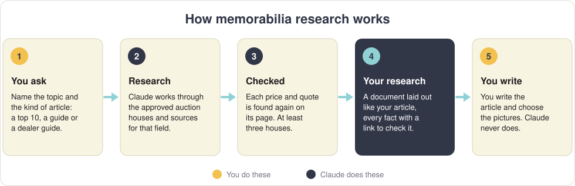
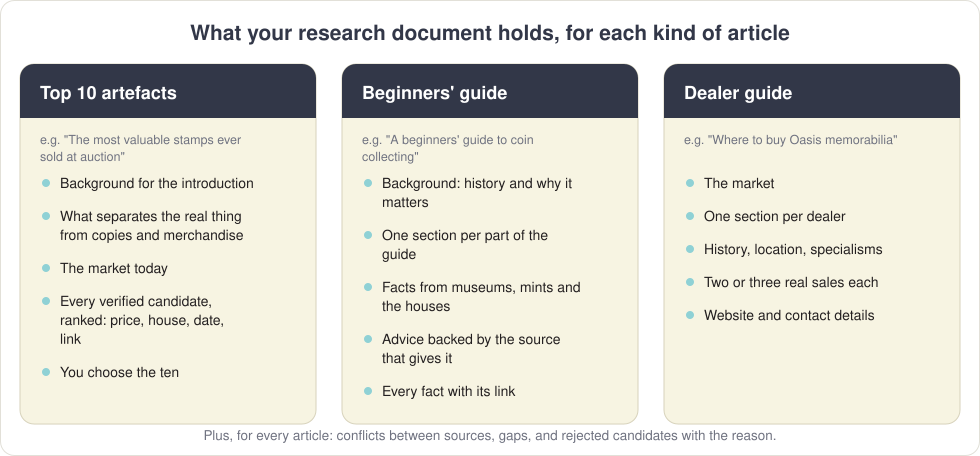
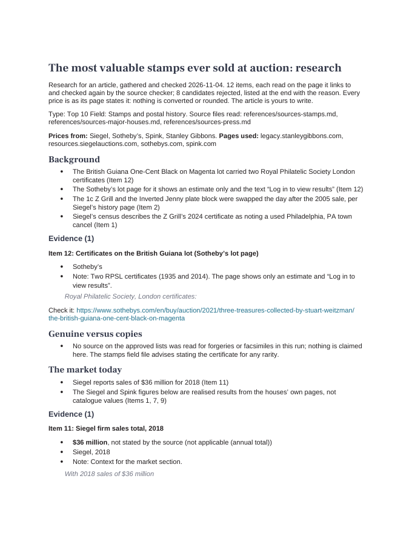
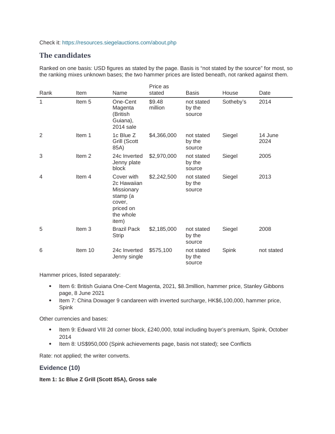

# Memorabilia research

**Tell Claude what article you want to write about collectibles. It researches it, checks every fact against the page it came from, and hands you a research document. You write the article.**

<p align="center"></p>

> [!IMPORTANT]
> **Claude never writes the article, and never chooses the pictures.** It gathers the facts and proves each one. The words and the pictures are yours.

It covers art, coins, comics, music and film memorabilia, stamps, trading cards, wine and spirits, toys, autographs and historical documents, political, sports and royal memorabilia, space and aviation, photography, and rare books.

---

## What you get

<p align="center"></p>

<table>
<tr>
<td width="50%"></td>
<td width="50%"></td>
</tr>
</table>
<p align="center"><em>Two pages of a real research document: "The most valuable stamps ever sold at auction".</em></p>

One document, laid out the way your article will be, as a **Word file** (opens in Word, LibreOffice or Google Docs) and a **Markdown file** (opens in Obsidian). In it:

- **Notes for each part of the article**: short facts, each with the item it comes from. For a top 10, that's the background for your introduction, what separates the real thing from copies and merchandise, the market today, and **every verified candidate ranked by price**, so you choose the ten.
- **The evidence behind each fact**: the price exactly as the auction house printed it, whether it includes the buyer's premium, the house, the date, the sentence copied from the page, and **a link to check it yourself**.
- **Conflicts**: where two sources disagree, both figures and both sources. You decide.
- **Gaps**: what the article needs that couldn't be found or checked, and any page you could check by hand.
- **Rejected candidates**: everything that didn't make it, and why.

---

## How it makes sure the facts are right

- **Approved sources only.** Each collecting field has its own list of auction houses and dealers that may be quoted for a price. The press can give background, never a price on its own.
- **At least three auction houses.** One house's archive could fill a top ten by itself; that's a catalogue, not a survey of the market.
- **Every page is read.** A search result is only a way to find a page. If the page doesn't say it, it isn't in your research.
- **Every figure is checked twice.** Before the document is made, every page is fetched again and every price and quote must be found on it. If anything is missing, no document is made until it's fixed.
- **Nothing made up, converted or rounded.** No price from memory. Prices stay in the currency they sold in: converting them is part of writing.

---

## Before you start: what you need

- [ ] **The Claude app on your computer**, with its **Code** tab, on a paid Claude plan.
- [ ] **Python 3**, which comes with a Mac set up as on the [Collecting Daily page](https://github.com/CollectingDaily).
- [ ] **pandoc**, for the Word copy (`brew install pandoc`). Without it you get the Markdown file only.

## Installing it

1. **Open the Claude app**, click the **Code** tab, choose **Local** and any folder (such as Documents).
2. **Paste this** into the message box and press **Return**:

   ```text
   Install the skill from https://github.com/CollectingDaily/claude-memorabilia-skill into ~/.claude/skills/claude-memorabilia-skill
   ```

3. **Click Allow** when Claude asks to download it.
4. **Quit the Claude app completely** (⌘ Q) and open it again. Type **/** in the message box and look for **memorabilia-research** in the list. If it's there, you're ready.

New to Claude, or setting up a Mac for the first time? The [Collecting Daily page](https://github.com/CollectingDaily) explains everything step by step.

---

## Using it

1. **Open the Claude app**, click **Code**, choose **Local** and **select the folder** where you keep your work.
2. **Say what you want to write**, and what kind of article it is:

| Kind of article | Type, for example |
| --- | --- |
| A top 10 | `/memorabilia-research Research a top 10 article on the most valuable stamps ever sold at auction` |
| A beginners' guide | `/memorabilia-research Research a beginners' guide to collecting stamps` |
| A dealer guide | `/memorabilia-research Research a where-to-buy guide to Oasis memorabilia` |

3. **Click Allow** when Claude asks to search, read pages or run its checks.
4. **Wait.** It reads every page it uses, so a full run takes a while.
5. **Open your research.** It's in a new folder, inside the one you chose:

```
Article research/
    2026.11.04 — most-valuable-stamps-sold-at-auction/
        The most valuable stamps ever sold at auction research.docx   ← open this in Word or Google Docs
        The most valuable stamps ever sold at auction research.md     ← or this one in Obsidian
        sources-log.md, rejected.md, notes.md                          ← Claude's working files
```

Then write your article, with your own words and your own pictures.

---

## Questions

**Can it write the article for me?**
No, by design. It researches and checks; you write. If you ever use AI to help with wording, run the result through the [humaniser](https://github.com/CollectingDaily/claude-humaniser) before it goes anywhere.

**Does it find pictures?**
No. You choose the pictures. The links in your research take you to the auction pages, where the lots are photographed.

**Can I trust the figures?**
Every price and quote was found on its page before the document was made. The links are there so you can look for yourself, and you should for anything you lead with.

**Why are some prices in dollars?**
Each price is shown as it was sold. Convert it when you write.

**Some candidates were rejected. Why?**
The reason is next to each one: the page didn't state the price, it wouldn't open, it was the same object twice, or the seller isn't on the approved list.

**It says a page couldn't be opened.**
Some auction houses only show prices to people who are signed in. Those pages are listed under **Gaps** with their links, so you can check them in your own browser.

---

<details>
<summary><strong>For the technically minded</strong></summary>

`SKILL.md` is the full procedure. The source lists for every field are in `references/`. Each verified item is logged in `sources-log.md`; `scripts/build_research.py` checks the log against the pages (`scripts/verify_sources.py` for priced items: price and quote on the page, duplicates, at least three houses; the quote on the page for facts and prices in words), then checks the notes (every price and percentage in the item named on its line, every link in the log), and only then writes the document, copying every item from the log rather than retyping it. The Word copy is made by pandoc with `assets/research-reference.docx` for its style. Python 3 standard library only.

</details>
